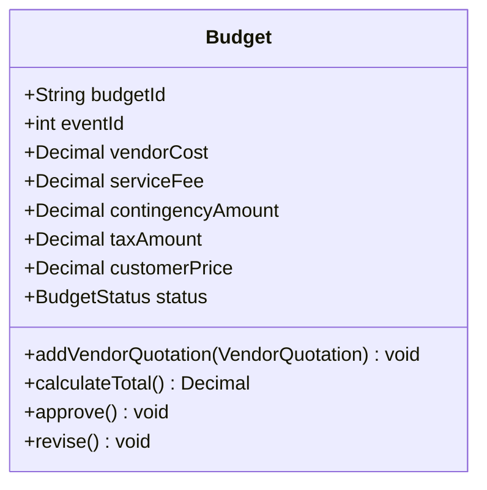

# Stage 2 architecture records

## KAN-29 internal financial persistence extension (2026-10-22)

FinancialRecordService is a Stage 2 internal SQLite implementation helper.
Review of the Stage 1 report pp24/26/47/48 found no direct conflict with its UML;
this does not mean Stage 1 explicitly authorized this new class. The user approved
this implementation extension after the read-only review. Existing inheritance,
domain relationships, PaymentService signatures and Budget.calculate_total()
responsibility are retained. budget_fingerprint and list-order semantics are unchanged.

Agent delegates persistence through Services. Pure quotation validation is shared
by quotation generation and deposit validation. Dedicated financial tables preserve
schema-versioned snapshots and a conservative customer-deposit execution journal.
KAN-27 tables and workflow remain intact; its event query reads existing payloads.
No automatic reconciliation, database migration or cross-process exactly-once is added.
Identity rules are in [KAN-29 plan section 2](kan29-persistence-plan.md#2-记录身份不可变内容与恢复);
transactions and failure protection are in section 4 of that plan.

## Approved MVP scope (KAN-27, 2026-10-22)

User approved a single VendorSettlementService for structured preparation and
explicit simulation, with Financial-owned SQLite persistence. PaymentService
signatures and Payment -> VendorPayment inheritance remain unchanged.
FinancialManagerAgent.settle_vendor_payment(booking) retains its UML signature
as a documented legacy stub because it cannot receive invoice/completion evidence;
the additive Agent actions use the single settlement service instead.

Business Owner Approval and vendor prepayments are deferred requirements, not
implicitly satisfied. approved_at stays null; no approve_settlement call or
fabricated approval occurs. pending/paid/failed are MVP handoff states, not a
mapping to UML Confirmed. Structured mock service completion is separate from
the immutable Procurement Confirmed booking. Booking -> VendorPayment (0..1)
is enforced by SQLite booking uniqueness. Workflows are serialized; cross-process
execution and crash recovery are deferred, with manual review after uncertain saves.

## UC4 Budget adjustment

Date: 2026-10-21. Approval: user explicitly approved proposal items 1 and 3,
and specified taxAmount remains integer zero for V1 instead of None.

Stage 1 Report p26 Budget is retained. Add `serviceFee: Decimal`, mapped to
`service_fee_cents: int`. Existing constructors remain compatible with zero
initial service fee; `calculate_total()` computes and overwrites it for V1.
Keep `taxAmount: Decimal` / `tax_amount_cents: int`; V1 uses 0 as an approved
placeholder meaning no separate tax breakdown, not that prices contain no GST.
All V1 amounts are GST-inclusive and no GST is added or inferred separately.

This is the approved Budget fragment; the complete Report's relationships,
inheritance and Agent/Service method signatures remain unchanged.
`Budget.calculate_total()` independently computes 10% service fee and 10%
contingency from selected vendor costs, ROUND_HALF_UP to integer cents.
Integer `(vendor_cents + 5) // 10` is exactly that rounding for nonnegative
integer cents, including amounts larger than the default Decimal precision.
No BudgetService is introduced. PaymentService remains untouched.

Budget's transient selected quote snapshots implement its existing aggregation;
they are not database persistence. KAN-29 separately persists the FIN-01 handoff
through FinancialRecordService. Internal `Calculated` string denotes a
calculation record only, not customer approval or an added UML status transition.
