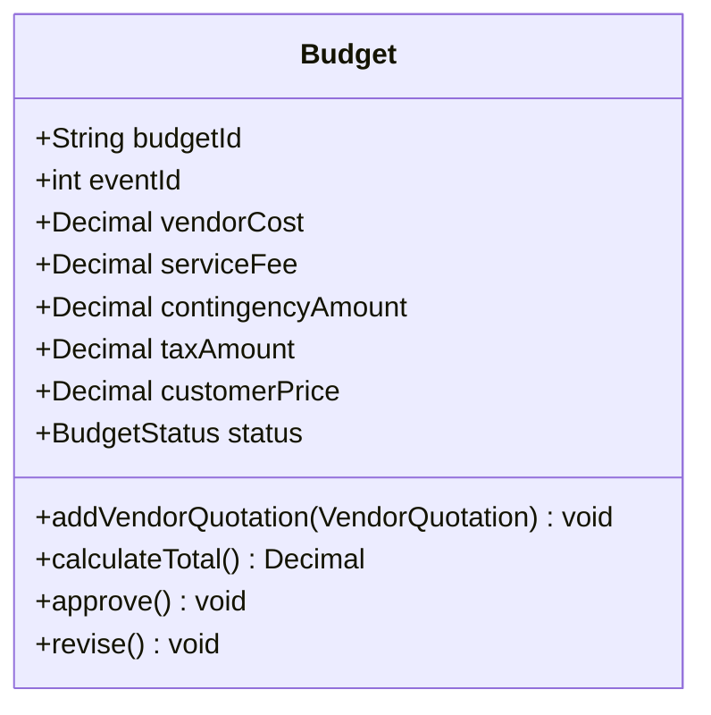

# Approved UC4 V1 UML adjustment

Date: 2026-10-21. Approval: user explicitly approved proposal items 1 and 3,
and specified taxAmount remains integer zero for V1 instead of None.

Stage 1 Report p26 Budget is retained. Add `serviceFee: Decimal`, mapped to
`service_fee_cents: int`. Existing constructors remain compatible with zero
initial service fee; `calculate_total()` computes and overwrites it for V1.
Keep `taxAmount: Decimal` / `tax_amount_cents: int`; V1 uses 0 as an approved
placeholder meaning no separate tax breakdown, not that prices contain no GST.
All V1 amounts are GST-inclusive and no GST is added or inferred separately.

This is the approved Budget fragment; the complete Report's relationships,
inheritance and Agent/Service method signatures remain unchanged.
`Budget.calculate_total()` independently computes 10% service fee and 10%
contingency from selected vendor costs, ROUND_HALF_UP to integer cents.
Integer `(vendor_cents + 5) // 10` is exactly that rounding for nonnegative
integer cents, including amounts larger than the default Decimal precision.
No BudgetService is introduced. PaymentService remains untouched.

Budget's transient selected quote snapshots implement its existing aggregation;
they are not database persistence. Internal `Calculated` string denotes a
calculation record only, not customer approval or an added UML status transition.
