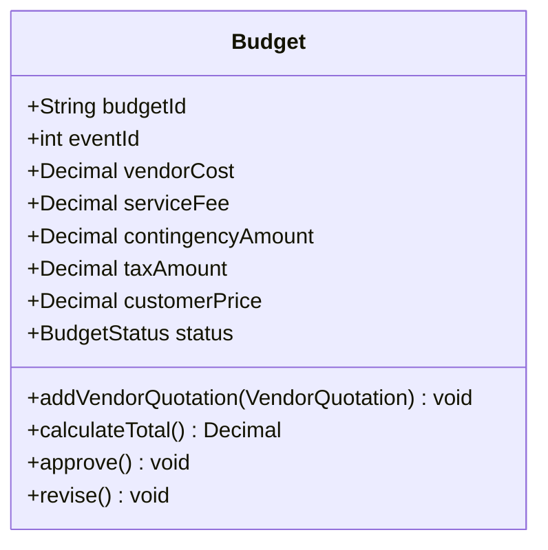

# Stage 2 architecture records

## Financial standalone demo UI (2026-10-23)

User authorized implementation of docs/financial-ui-mvp-plan.md with Operations
unavailable. src/demo contains local orchestration and fixture adapters, not a new
business Agent, Supervisor, PlanningService or EventOperationsService implementation.
Review of Stage 1 report pp24/47/48 supports keeping calculations and persistence
in existing domain/Service implementations; no existing inheritance, associations,
PaymentService signatures or legacy UML stubs were changed. This helper extension
was authorized by the implementation request, not claimed as an original UML class.

FinancialDemoApp calls Procurement and Financial Agents separately; Agents never
import each other. Budget and payment rules remain in existing Services. SQLite
demo_financial_contexts supplies durable current demo context/customer approval;
demo_operations_evidence stores explicit immutable mock invoices/completions and
a fixed activity-wide booking scope. Revision checks reject stale updates. Inputs
freeze after a collection request. Saved financial facts are never cleared.

All Services receive one explicit database path: ELEC5620_DB_PATH or the local UI
default runtime/financial-demo.sqlite3. Demo-only vendor_execution_attempts in the
context commits before a pending supplier execution. A pending result with a prior
attempt blocks retries after restart; terminal results replay through the existing
service. This conservative guard does not change KAN-27 execution semantics outside
the demo coordinator and does not claim automatic recovery/exactly-once execution.

Single operator and serial supplier execution only. No real Operations completion,
Planning approval authority, LangGraph/FastAPI integration or event closure is claimed.
AppTest covers page interaction; browser visual/manual acceptance remains separately
required. Jira issue and member attribution must use actual team-provided identities.

## KAN-32 read-only financial reconciliation (2026-10-22)

User approved FinancialReconciliationService as an internal helper and injectable
trusted current-context / Operations-scope providers. Existing Agent inheritance,
PaymentService and reconcile_payments(event_id: str) -> bool remain intact.
Both Agent entry points share reconciliation logic; Boolean returns false for
business blocks and raises FinancialStorageError for system read errors.

FinancialRecordService opens an existing database using mode=ro, query_only and
BEGIN. Its existing _balance calculation, Procurement snapshot reads and vendor
history reads share that connection. No tables, requests, payment facts or event
states are written during reconciliation. Initialized record services are injected.
Current authority remains a trusted Integration handoff, validated against stored
budget/customer quote; no independent current-revision store is claimed.

Operations supplies the complete settlement scope independently of payment history;
each booking references its proposal, allowing outstanding historical obligations.
Confirmed full quotation amounts remain the vendor payable basis. Missing or invalid
evidence blocks; data-access failures produce error. No payment provider is used.
See shared-data-and-interfaces.md §5.11. Tests/demos use STUB Operations scope;
real Operations integration and final event closure acceptance remain deferred.

## KAN-31 supplier settlement conditions (2026-10-22)

User explicitly authorized no Owner Approval requirement for this prototype.
This clarifies KAN-27's deferral: no approval subsystem is implemented and missing
Owner approval does not block settlement. approved_at remains null, never fabricated.
Customer approval remains mandatory. VendorSettlementService now checks current
persisted budget/quote, external current customer approval, activity-wide approved
vendor capacity and durable available receipts before preparation/pending execution.
FinancialRecordService provides activity funds through Services; existing Agent
inheritance, PaymentService signatures and serialized KAN-27 execution remain intact.
The pre-execution gate is the future extension point for Owner approval.
See docs/kan31-settlement-budget-plan.md and shared-data-and-interfaces.md section 5.8.

## KAN-30 customer balance and final payment (2026-10-22)

User approved CustomerBalanceService as an internal Stage 2 helper and a shared
transactional collection claim for deposits/finals in FinancialRecordService.
FinancialManagerAgent delegates structured balance/preparation/simulation actions;
CustomerPayment inheritance, PaymentService signatures and Stage 1 relationships
remain unchanged. No Agent computes money or accesses SQLite directly.

Final requests have independent execution states and immutable saved payment
results. BEGIN IMMEDIATE serializes balance checks and durable execution claims
for each event/customer across both payment entry points. Claims survive uncertain
outcomes; terminal result saves release them atomically. Historical successful
deposits span quote revisions; only valid durable success evidence counts.
Existing deposit journal state names remain compatible. New final-request and
claim tables are additive; the original tables and vendor workflow are retained.
See shared-data-and-interfaces.md §5.10 for contracts and recovery limitations.

## KAN-29 internal financial persistence extension (2026-10-22)

FinancialRecordService is a Stage 2 internal SQLite implementation helper.
Review of the Stage 1 report pp24/26/47/48 found no direct conflict with its UML;
this does not mean Stage 1 explicitly authorized this new class. The user approved
this implementation extension after the read-only review. Existing inheritance,
domain relationships, PaymentService signatures and Budget.calculate_total()
responsibility are retained. budget_fingerprint and list-order semantics are unchanged.

Agent delegates persistence through Services. Pure quotation validation is shared
by quotation generation and deposit validation. Dedicated financial tables preserve
schema-versioned snapshots and a conservative customer-deposit execution journal.
KAN-27 tables and workflow remain intact; its event query reads existing payloads.
No automatic reconciliation, database migration or cross-process exactly-once is added.
Identity, recovery and transaction rules are in shared-data-and-interfaces.md
§5.9, extended by §5.10 for shared customer collection protection.

## Approved MVP scope (KAN-27, 2026-10-22)

User approved a single VendorSettlementService for structured preparation and
explicit simulation, with Financial-owned SQLite persistence. PaymentService
signatures and Payment -> VendorPayment inheritance remain unchanged.
FinancialManagerAgent.settle_vendor_payment(booking) retains its UML signature
as a documented legacy stub because it cannot receive invoice/completion evidence;
the additive Agent actions use the single settlement service instead.

Business Owner Approval and vendor prepayments are deferred requirements, not
implicitly satisfied. approved_at stays null; no approve_settlement call or
fabricated approval occurs. pending/paid/failed are MVP handoff states, not a
mapping to UML Confirmed. Structured mock service completion is separate from
the immutable Procurement Confirmed booking. Booking -> VendorPayment (0..1)
is enforced by SQLite booking uniqueness. Workflows are serialized; cross-process
execution and crash recovery are deferred, with manual review after uncertain saves.

## UC4 Budget adjustment

Date: 2026-10-21. Approval: user explicitly approved proposal items 1 and 3,
and specified taxAmount remains integer zero for V1 instead of None.

Stage 1 Report p26 Budget is retained. Add `serviceFee: Decimal`, mapped to
`service_fee_cents: int`. Existing constructors remain compatible with zero
initial service fee; `calculate_total()` computes and overwrites it for V1.
Keep `taxAmount: Decimal` / `tax_amount_cents: int`; V1 uses 0 as an approved
placeholder meaning no separate tax breakdown, not that prices contain no GST.
All V1 amounts are GST-inclusive and no GST is added or inferred separately.

This is the approved Budget fragment; the complete Report's relationships,
inheritance and Agent/Service method signatures remain unchanged.
`Budget.calculate_total()` independently computes 10% service fee and 10%
contingency from selected vendor costs, ROUND_HALF_UP to integer cents.
Integer `(vendor_cents + 5) // 10` is exactly that rounding for nonnegative
integer cents, including amounts larger than the default Decimal precision.
No BudgetService is introduced. PaymentService remains untouched.

Budget's transient selected quote snapshots implement its existing aggregation;
they are not database persistence. KAN-29 separately persists the FIN-01 handoff
through FinancialRecordService. Internal `Calculated` string denotes a
calculation record only, not customer approval or an added UML status transition.
